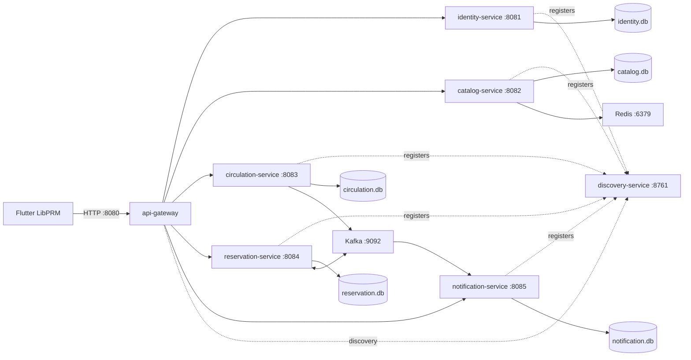

# Library Server - Infrastructure handoff

This repository is the `Assigment/` server root from the team playbook. Do not create another application root. Owner: Hà Minh Mẫn. Tasks: MSS-001, MSS-002, MSS-003, MSS-004, MSS-005, MSS-045.

## Build and coding convention (MSS-002)

Use JDK 21, Maven 3.9+, Spring Boot 4.1.1 and Spring Cloud 2025.1.2. Versions and the seven canonical modules are managed by the root `pom.xml`. The version pair follows https://spring.io/projects/spring-cloud/ . Child POMs inherit the parent; no service depends on another service JAR. `renting-sevice` is deprecated, absent from this checkout and excluded from the reactor. Removing legacy code requires a separate approved cleanup.

From this directory:

```sh
mvn test
mvn -pl catalog-service test
mvn -pl api-gateway test
mvn package
```

A child build resolves its parent through `../pom.xml`, so installation of the parent is unnecessary. Existing per-module Maven wrappers remain available, for example `identity-service/mvnw.cmd -f pom.xml -pl identity-service test` on Windows. Maven tests disable Eureka network registration/fetch and use a private in-memory SQLite database per service JVM. Flyway migrations still execute; tests never touch local database files.

Use UTF-8, Java 21, four spaces in Java, two spaces in new YAML/XML, package names beneath the existing service package, and constructor injection. Feature packages may contain controller/dto/entity/repository/service/mapper as needed. Do not import another service's entities or repositories. Keep commits small, prefixed by task ID. Run the relevant module tests before integration. Domain migrations are append-only and remain with their assigned owners.

## ADR-001: Service and data boundaries (MSS-001)

Status: accepted for the supplied infrastructure scope, 2026-10-23. The original backlog mentions PostgreSQL, but the later explicit team contract requires SQLite. This implementation follows that contract.



Identity owns users, roles and authentication. Catalog owns books, copies, authors, categories and publishers. Circulation owns loans and due-date rules. Reservation owns queues. Notification owns notifications. Each service exclusively owns its SQLite file and Flyway migrations. Discovery and Gateway have no database and no domain logic. IDs crossing services are string/UUID references, with no cross-service foreign keys or shared files. Existing domain schemas are untouched; any mismatch in their IDs remains with domain owners.

Synchronous checks use REST (WebClient/OpenFeign); client requests go through Gateway. Kafka carries asynchronous side effects, with local transactional outbox and eventId deduplication to be implemented by domain owners. No distributed database transaction is introduced.

Local storage defaults to `data/<service-name-without-suffix>.db` relative to the service working directory. Start local JARs from their module directories; this yields `identity-service/data/identity.db`, etc. Set `SQLITE_PATH` to an absolute file path when launching from elsewhere. SQLite URL options enable foreign keys, WAL and a 5000 ms busy timeout. Hikari allows one connection and Hibernate uses `ddl-auto=none`. Existing database files are not moved, deleted or migrated by this work.

## Start the entire local stack (MSS-003/004/005/045)

Prerequisite: Docker Engine with Compose v2 running, network access to image registries/Maven Central, ports 8080, 8761, 6379 and 9092 available. From the repository root:

```sh
docker compose up --build -d --wait --wait-timeout 300
```

This builds all seven Java services and starts Discovery, Gateway, Redis, single-node Kafka in KRaft mode, and an idempotent topic-init job. Each application uses the shared multi-stage Java 21 Dockerfile and runs as non-root. Stateful services use separate Docker volumes mounted at `/app/data`; Redis uses AOF and Kafka persists broker data. Compose injects the `docker` profile, server port, Eureka URL, Redis host/port and Kafka bootstrap servers. Readiness checks gate startup dependencies. Domain service ports stay internal; Gateway is the client entry point. Local profiles default to `local` and use localhost infrastructure.

```sh
docker compose ps
powershell -ExecutionPolicy Bypass -File scripts/verify-stack.ps1
docker compose logs --tail=100 api-gateway
curl http://localhost:8761/actuator/health
curl -H "Accept: application/json" http://localhost:8761/eureka/apps
curl http://localhost:8080/actuator/health/readiness
curl http://localhost:8080/actuator/metrics
curl http://localhost:8080/actuator/prometheus
docker compose exec catalog-service curl -fsS http://localhost:8082/actuator/health
```

Eureka should list Gateway plus all five domain service IDs (registration may take up to a minute). Discovery is a standalone server and does not register itself. All seven expose `/actuator/health`, `/actuator/health/liveness`, `/actuator/health/readiness`, `/actuator/metrics` and `/actuator/prometheus`. Actuator details are hidden and Gateway does not proxy downstream Actuator paths. Readiness denotes application readiness; it does not assert future domain consumers/outbox functionality.

To run one Java service on the host, start shared infrastructure then run from the root:

```sh
docker compose up -d redis kafka kafka-init discovery-service
mvn -pl catalog-service spring-boot:run
```

The Maven Boot plugin runs in the module directory. Host processes use Kafka `localhost:9092`; containers use `kafka:19092`. Override `SERVER_PORT`, `EUREKA_URL`, `SQLITE_PATH`, `REDIS_HOST`, `REDIS_PORT`, `KAFKA_BOOTSTRAP_SERVERS` as needed. Keep canonical ports for team integration.

Stop with `docker compose down`. Named volumes retain data. Do not use `down -v` unless intentionally discarding local databases and broker/cache data. The empty `discovery-service/compose.yaml` is obsolete; always use the root Compose file.

## Gateway handoff (MSS-004)

Canonical prefixes route through Eureka and strip two path segments:

- `/api/identity/**` -> `identity-service:8081` (authentication and users)
- `/api/catalog/**` -> `catalog-service:8082` (books, authors, categories, publishers)
- `/api/circulation/**` -> `circulation-service:8083`
- `/api/reservation/**` -> `reservation-service:8084`
- `/api/notification/**` -> `notification-service:8085`

For example `/api/catalog/books?page=2` forwards `/books?page=2`; downstream controller paths must match. Existing `/identity/**`, `/catalog/**`, `/circulation/**`, `/reservation/**`, `/notification/**` aliases remain temporarily for compatibility and strip one segment. New clients must use `/api`. Unknown routes return 404. The current domain modules mostly contain scaffolding, so routed feature URLs may return 404 until their owner implements controllers.

Gateway forwards/returns `X-Trace-Id`, preserving an incoming alphanumeric/hyphen ID of at most 64 characters or generating a UUID. Domain owners can use that value for the response envelope `traceId` and event `traceId`. CORS defaults to `http://localhost:3000`; set `CORS_ALLOWED_ORIGINS` to a comma-separated allowlist for browser clients. Native Android is not governed by browser CORS. Flutter's emulator base URL is `http://10.0.2.2:8080`; physical devices use the host LAN URL through `--dart-define`.

JWT validation and RBAC belong to MSS-008 (Nguyễn Điền Trung Hiếu), dependent on MSS-006 (Trương Thiếu Trọng). This gateway currently routes without authentication; use the stack for local development until that integration is complete. Its security filter must cover both canonical routes and legacy aliases. Domain services must validate identity/role for sensitive operations. No JWT secret or security response contract is invented here.

## Redis and Kafka handoff (MSS-005)

Catalog owns `catalog:book:{id}` and `catalog:book:list:{hash}`, TTL 5 minutes; invalidate after the SQLite transaction succeeds. Redis client/cache behavior is MSS-041, not infrastructure behavior.

Compose creates these existing agreed topics with one partition/replica for local development:

- `library.loan.approved.v1`: Circulation -> Notification.
- `library.loan.returned.v1`: Circulation -> Reservation and Notification.
- `library.loan.overdue.v1`: Circulation -> Notification.
- `library.reservation.ready.v1`: Reservation -> Notification.

Event fields are `eventId`, `occurredAt`, `traceId`, `type`, and immutable payload. Domain owners implement the outbox, serializers, consumer groups and idempotency in MSS-039. Auto topic creation is disabled. Adding a topic or changing its shape requires the shared-contract change process. Redis/Kafka connection properties are supplied now; domain dependencies should be added by their feature owner when used.

## Verification and next integration

See `docs/team-playbook/HANDOFF.md` for actual verification results. No migration was added or edited. No domain Java code was changed. Next: MSS-006 authentication and MSS-008 Gateway security; then domain controllers using the documented paths, MSS-041 cache, and MSS-039 Kafka outbox/consumers. Production TLS, multi-node Kafka, secrets and deployment policy are outside this local infrastructure scope.
